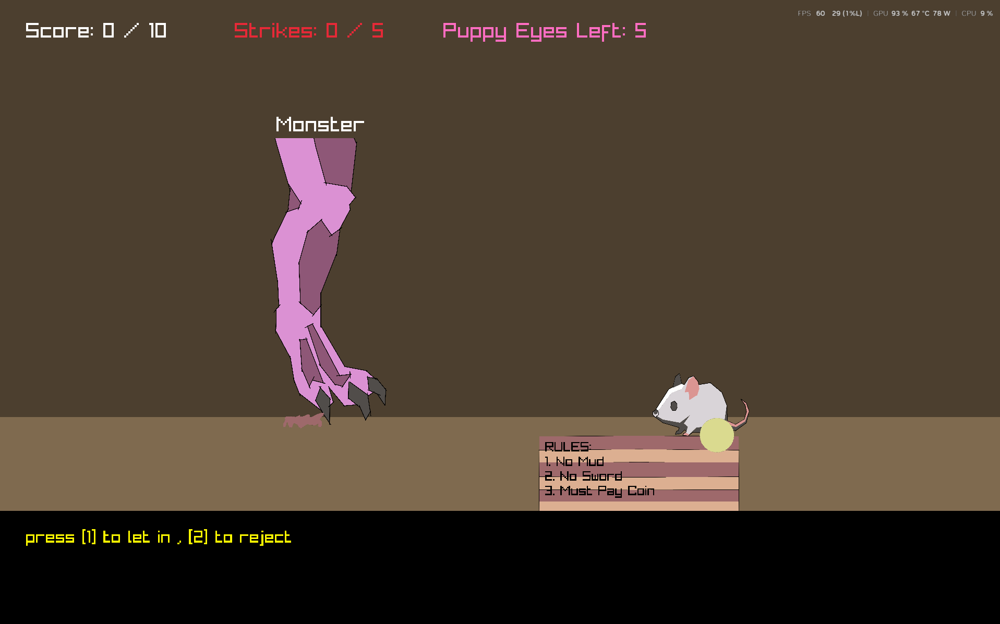
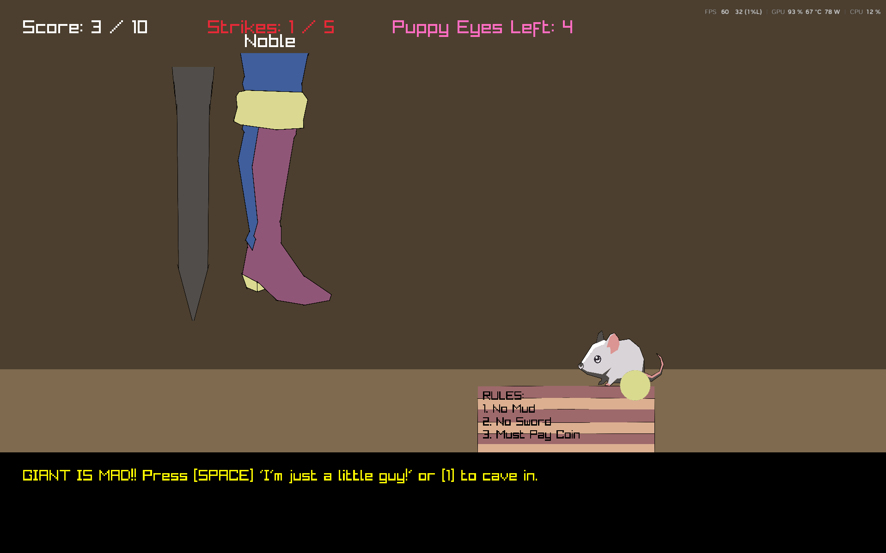
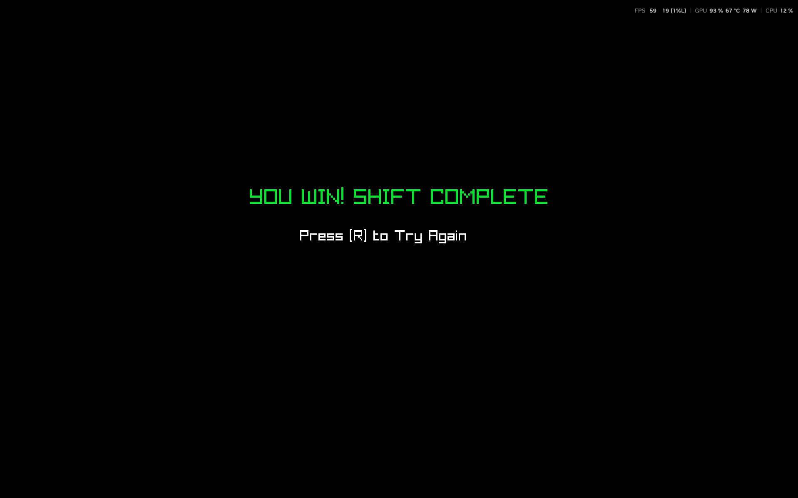

# Little Guardian

The little mouse is the guardian to a door way . The mouse is very hardworking but has his ways to deal with shenanigans .

## How to play
- Press 1 to let the person enter
- Press 2 to reject
- Spacebar for puppy eyes
- In angry mode , Press 1 to cave in
- On the game end screen , Press [R] to replay.

## Rules
1. To enter the person must pay a coin.(On the mouse's desk)
2. No mud on the boots.
3. Must not carry any weapon.

## Strikes and Score
1. Each correct person entered adds up to the score .
2. Each puppy eyes used ass up to the score.
3. Each wrong person entered is one strike.
4. Each cave in is one strik.

## Gameplay 
- each new person will be a random one.
- can hold weapon , have muddy shoes.
- player can hold upto 5 strikes and will be given 5 puppy eyes only.
- game ends if the score is 10(victory) or when the player has 5 strikes (game over).

## Images

